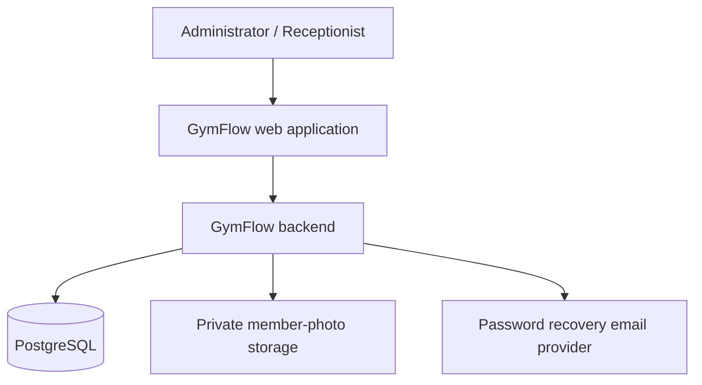
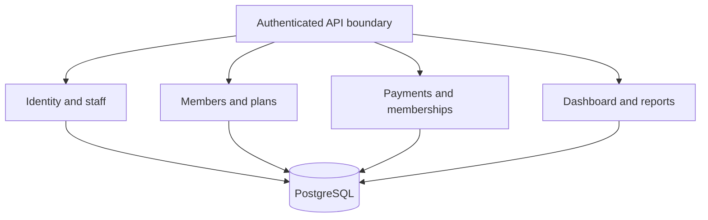
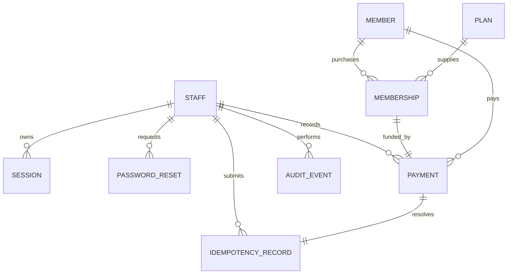

# GymFlow — Version 1 Backend, Database and System Design

**Document type:** design specification only. No implementation code or database scripts.

**Companion:** design.md — Version 1 frontend design specification.

## 1. Purpose and boundaries

GymFlow helps one gym register members, verify paid membership validity, record payments, renew memberships, and review basic financial reports. Users are administrators and receptionists. Members do not sign in during Version 1.

Included: staff authentication and recovery, member management, membership plans, full payment recording, validity calculation, renewal, histories, printable receipt data, basic reports, staff management, gym settings, and account preferences.

Deferred: attendance, QR scanning, automated expiration reminders, online payment processing, debt/partial payments, refunds, freezing, multiple branches, advanced analytics, and report export. Password recovery email is an authentication function; it is separate from deferred membership reminder messaging.

Currency is ETB; operational timezone is Africa/Addis_Ababa; membership dates use the Gregorian calendar. Version 1 plans have fixed day durations.

## 2. Proposed architecture

Use a modular monolith: one backend application divided into business modules, with one PostgreSQL database. This keeps the payment and membership workflow within one transaction and limits deployment complexity for a single gym.

The frontend uses Next.js, TypeScript and Tailwind CSS. The backend can use Next.js server routes or a separate TypeScript service such as NestJS. The contracts in this document remain the same in either implementation. PostgreSQL is the relational database; an ORM such as Prisma is an implementation choice, not a design dependency.

### System context



The browser communicates with the backend over HTTPS. The browser never connects directly to the database. The email provider receives only the data needed to deliver account recovery links. Private photo storage is needed only when optional member photos are supported.

### Backend modules



Settings and audit logging are shared backend services. Database transactions are owned by business operations, particularly payment recording, staff role changes, password resets, and account deactivation.

## 3. Roles and authorization

| Operation | Administrator | Receptionist |
| --- | --- | --- |
| Sign in/out, recover/change own password | Allowed | Allowed |
| View operational dashboard and member lookup | Allowed | Allowed |
| Register/edit/view members | Allowed | Allowed |
| Record received payment and renew | Allowed | Allowed |
| View payment/member histories and receipt | Allowed | Allowed |
| Archive/reactivate a member | Allowed | Denied |
| Read enabled plans for a payment | Allowed | Allowed |
| Manage plans | Allowed | Denied |
| Read gym-wide financial dashboard/reports | Allowed | Denied |
| Manage staff and gym settings | Allowed | Denied |
| Change own appearance preference | Allowed | Allowed |

Enforce authorization in the backend on every request. Frontend navigation visibility is only a usability feature. Access is denied by default. A deactivated account loses access immediately, including through existing sessions. The last active administrator cannot be deactivated or demoted.

## 4. Backend responsibilities

| Module | Responsibilities | Main outputs |
| --- | --- | --- |
| Authentication | Verify credentials, create/revoke sessions, password recovery, forced first password change | Current account and session state |
| Staff | Create/edit accounts, roles, deactivate accounts | Staff records without password material |
| Members | Generate member IDs, validate contact details, register/edit/archive/reactivate | Member profile and searchable list |
| Plans | Define prices/durations, edit and disable | Current enabled plans and historical snapshots |
| Memberships | Compute coverage periods, validity and renewal start/end dates | Current status, next scheduled period, history |
| Payments | Record received full payments, prevent duplicates, preserve financial history | Transaction and associated membership |
| Receipts | Return printable receipt data | Gym details, payer, transaction and coverage |
| Dashboard | Aggregate operational counts and role-appropriate recent activity | Counts, expiring list, recent payments |
| Reports | Aggregate received payments and membership statistics | Date-range totals and breakdowns |
| Settings | Gym profile, warning threshold, available recording methods | Validated configuration |
| Media | Validate/store private optional member photos | Authorized photo access |
| Audit | Record sensitive successful changes and accountable payment entry | Restricted append-only events |

## 5. Membership and payment rules

### Membership validity

A member record is distinct from a membership period. Registering a member creates no paid access. A payment is distinct from the period purchased by that payment.

| Derived status | Meaning | Access today |
| --- | --- | --- |
| Active | Paid period covers today; remaining days exceed warning threshold | Valid |
| Expiring Soon | Paid period covers today; remaining days are between zero and warning threshold | Valid |
| Expired | No period covers today, no future period takes display priority, and a paid period ended in the past | Invalid |
| Unpaid | No paid membership has ever been recorded | Invalid |
| Scheduled | No period covers today and a future paid period exists | Invalid until start date |

Archived is an independent member-account flag. Archived records preserve financial history and cannot receive new payments until reactivated. The UI may still show their historical coverage status, but the operational list excludes archived accounts by default.

Status display priority: current paid period first; otherwise earliest future period; otherwise most recently ended period; otherwise Unpaid. If a member has expired past coverage and future scheduled coverage, show Scheduled plus the future start date. Never describe that member as currently active.

### Date calculation

- Start and end are inclusive date-only values.
- End date equals start date plus plan duration minus one day.
- A membership remains valid on its end date; it expires the following day in the gym timezone.
- Remaining days equals end date minus today, excluding today. On the end date show “Expires today.”
- Warning threshold defaults to seven days and can be set from zero to thirty.
- “Monthly” means 30 days, not one calendar month.
- Active totals include Expiring Soon. Counts must explain this to avoid double counting.
- Derive status when reading; do not depend on a daily job to mutate a stored status field.

### Renewal

For a member covered today, renewal starts after the final date in their continuous chain of already paid periods. Include any contiguous scheduled renewals so an early payment preserves purchased days.

For an expired or unpaid member, start defaults to today; staff may choose a future date. Backdated membership access is outside Version 1. Existing future periods must be checked for overlap before confirming a new period. Disconnected future periods do not automatically justify filling a gap; return a clear date-conflict error when a proposed purchase overlaps them.

### Consistent examples — today: October 7, 2026

| Scenario | Existing period | Purchase/start | Result |
| --- | --- | --- | --- |
| Active renewal | Oct 1–Oct 30; 30 days | Another 30-day plan | Oct 31–Nov 29 |
| Expired renewal | Sep 1–Sep 30 | Start today; 30 days | Oct 7–Nov 5 |
| First future purchase | None | Start Oct 12; 30 days | Oct 12–Nov 10; Scheduled |
| End-date access | Paid through Oct 7 | Check Oct 7 | Expiring Soon; expires today |
| Day after expiry | Paid through Oct 7 | Check Oct 8 | Expired |

### Financial rules

- Version 1 records payments already received; method labels do not initiate bank/card/mobile transactions.
- Full plan price is required. Amount is calculated server-side from the enabled plan; no client-submitted amount can override it.
- Supported methods: Cash, Bank Transfer, Card, Mobile Payment.
- Non-cash methods require a transaction reference. References may be used for duplicate warnings but are not globally unique without a defined bank/provider namespace.
- Received payment date defaults to today, may be earlier, and cannot be in the future. Record entry timestamp separately.
- Creating a payment and membership succeeds or fails together.
- A posted payment remains Paid even after membership expires.
- Posted payments and purchased membership snapshots cannot be edited/deleted through the application. Corrections/refunds require a separately designed later workflow; reviewers should confirm this operational policy before live use.
- Plan changes apply only to future purchases. Historical plan name, amount and duration stay as originally purchased.

## 6. Database model

Use relational entities with foreign keys, decimal money, date-only membership dates, timezone-aware timestamps, and opaque internal IDs. Human-readable member/payment codes are additional display identifiers.

### Entity relationships



One successful posted payment funds exactly one membership period. A member can have multiple successive or non-overlapping periods. The application transaction guarantees this relationship. An idempotency reservation may temporarily exist inside a transaction before its payment is created; incomplete reservations must never be committed as successful outcomes.

### Staff

| Field | Conceptual type | Constraint/purpose |
| --- | --- | --- |
| id | UUID | Primary key |
| full_name | Text | Required, trimmed |
| email | Text | Required, case-normalized, unique |
| password_hash | Text | Hash only; never returned by API |
| role | Enum | Administrator or Receptionist |
| is_active | Boolean | Defaults true |
| must_change_password | Boolean | True for administrator-created temporary credentials |
| appearance | Enum | Light, Dark, System; default System |
| created_at / updated_at | Timestamp | Account lifecycle |

### Member

| Field | Conceptual type | Constraint/purpose |
| --- | --- | --- |
| id | UUID | Primary key |
| member_code | Text | Required, unique, generated, e.g. GYM-00124 |
| first_name / last_name | Text | Required, trimmed |
| phone | Text | Required, canonical +251 format, unique under Version 1 policy |
| email | Text, optional | Validated when supplied |
| gender | Text, optional | Optional profile detail |
| photo_storage_key | Text, optional | Private storage reference; not an unrestricted public URL |
| emergency_name / emergency_phone | Text, optional | Both required if either is entered |
| emergency_relationship | Text, optional | Relationship label |
| address / notes | Text, optional | Bounded length |
| is_archived | Boolean | Default false; separate from membership status |
| registration_date | Date | Generated using gym date |
| created_at / updated_at | Timestamp | Record lifecycle |

Normalize accepted local forms such as 0911 234 567 to +251911234567 before checking uniqueness. Shared primary phone numbers are not supported in this Version 1 design; reconsider that assumption if the gym needs family accounts.

### Membership Plan

| Field | Conceptual type | Constraint/purpose |
| --- | --- | --- |
| id | UUID | Primary key |
| name | Text | Required; case-insensitive unique name |
| price | Decimal, 2 fraction digits | Positive ETB amount |
| duration_days | Integer | Positive fixed number of days |
| description | Text, optional | Bounded length |
| is_enabled | Boolean | Controls availability for new purchases |
| created_at / updated_at | Timestamp | Lifecycle |

Plans are disabled rather than deleted after use. No edit changes prior purchases.

### Membership

| Field | Conceptual type | Constraint/purpose |
| --- | --- | --- |
| id | UUID | Primary key |
| member_id | UUID | Required foreign key to Member |
| plan_id | UUID | Required foreign key to Plan |
| plan_name_snapshot | Text | Name at purchase time |
| price_snapshot | Decimal | Price at purchase time |
| duration_days_snapshot | Integer | Duration at purchase time |
| start_date / end_date | Date | Inclusive; end matches duration formula |
| is_renewal | Boolean | True if member had an earlier recorded purchase |
| created_at | Timestamp | Entry timestamp |

Do not store a mutable Active/Expired status as the authoritative value. Compute it from dates and settings. Prevent overlapping coverage for the same member using a database-level date-range exclusion constraint plus transaction/member locking in the backend. The exclusion constraint may require PostgreSQL’s btree_gist extension; confirm availability in the selected database host.

### Payment

| Field | Conceptual type | Constraint/purpose |
| --- | --- | --- |
| id | UUID | Primary key |
| payment_code | Text | Unique generated receipt identifier |
| member_id | UUID | Required foreign key to Member |
| membership_id | UUID | Required and unique foreign key to Membership |
| amount | Decimal | Positive; equals purchased membership price snapshot |
| currency | Enum | ETB for Version 1 |
| method | Enum | Supported enabled recording method at purchase |
| received_date | Date | No future dates |
| reference | Text, optional | Required for non-cash |
| notes | Text, optional | Bounded length |
| recorded_by | UUID | Required foreign key to Staff |
| created_at | Timestamp | Actual system entry time |

The payment’s member must equal the linked membership’s member. Financial foreign keys restrict deletion. Posted payment status is implicitly Paid in Version 1; an additional status enum is unnecessary until reversals/corrections are designed.

### Session

| Field | Conceptual type | Constraint/purpose |
| --- | --- | --- |
| id | UUID | Primary key |
| token_hash | Text | Unique hash of opaque session token |
| staff_id | UUID | Owner |
| expires_at | Timestamp | Fixed maximum lifetime |
| last_seen_at | Timestamp | Optional inactivity policy |
| created_at | Timestamp | Creation |

Store only a token hash. The browser receives the opaque token in an HttpOnly, Secure cookie. Revoke sessions on logout, password reset/change, and staff deactivation.

### Password Reset

| Field | Conceptual type | Constraint/purpose |
| --- | --- | --- |
| id | UUID | Primary key |
| token_hash | Text | Unique, hashed recovery token |
| staff_id | UUID | Account being recovered |
| expires_at | Timestamp | Short lifetime, proposed 30 minutes |
| consumed_at | Timestamp, optional | Single-use tracking |
| created_at | Timestamp | Creation |

Recovery request responses must not disclose whether an account exists. A successful reset consumes the token and revokes existing sessions atomically.

### Idempotency Record

| Field | Conceptual type | Constraint/purpose |
| --- | --- | --- |
| staff_id | UUID | Submitting actor |
| request_key | UUID | Client-generated operation key |
| request_fingerprint | Text | Digest of normalized payment request |
| payment_id | UUID | Successful result |
| created_at | Timestamp | Retention record |

Unique pair: staff_id + request_key. Same key/same body returns the same transaction; same key/different body returns a conflict. Preserve successful payment keys for the life of the associated financial record.

### Gym Settings

A singleton configuration record for the one gym: gym name, optional contact/email/address/logo storage key, currency ETB, timezone Africa/Addis_Ababa, expiration warning days 0–30 (default 7), enabled payment methods with at least one method. Track updated_at and updated_by.

### Audit Event

Fields: id, actor_id, action, entity_type, entity_id, timestamp, optional request correlation ID and sanitized change summary. Record payment creation, staff creation/role/deactivation, member archive/reactivation, plan edits and settings changes. Do not log raw passwords, session/reset tokens, entire request bodies or unnecessary personal data. Events are append-only and administrator-restricted.

## 7. Database constraints and indexing

| Concern | Database rule |
| --- | --- |
| IDs | Internal primary keys and unique display codes |
| Identity | Case-insensitive unique staff email; normalized unique member phone |
| Referential integrity | Required foreign keys; restrict financial-history deletion |
| Money | Fixed-precision decimal with positive amounts |
| Dates | Valid inclusive period; snapshot duration matches dates |
| Coverage | Per-member exclusion of overlapping date ranges |
| Payment relationship | One payment per membership; matching member IDs |
| Duplicates | Unique actor/request key; unique generated payment code |
| Settings | Warning bounds; valid nonempty payment-method selection |
| Password recovery | Unique token digest, bounded expiry, single consumption |

Recommended indexes: member_code; phone; normalized member name search; membership member_id/start_date/end_date; membership end_date; payment received_date; payment member_id/received_date; payment recorded_by; session token_hash and expires_at; reset token_hash and expires_at; audit timestamp/entity; unique idempotency actor/key.

For small gyms, indexed prefix/name matching is sufficient. If substring search becomes slow, consider PostgreSQL trigram indexing after measuring actual queries. Paginate all lists; avoid loading entire payment history into the browser.

## 8. API design conventions

Base path: **/api/v1**. Requests and responses use JSON except photo upload/download. Authenticate staff requests through the session cookie. Use HTTPS and explicit origin/CSRF protection for cookie-authenticated writes. If frontend/backend are separate origins, allow only the configured frontend origin and credentialed requests; avoid wildcard origins.

- Return date-only values as YYYY-MM-DD and timestamps as ISO 8601 with timezone.
- Return money as decimal strings such as “1500.00” plus currency “ETB”.
- Lists accept page and pageSize, with a bounded maximum (proposed 100).
- List responses include items, total, page and pageSize.
- Allow only documented sorting fields and directions.
- Errors include code, message, fieldErrors when relevant, and requestId.
- Never return password hashes, token hashes, private storage credentials or internal stack traces.
- Validate inputs server-side, including unknown fields, field lengths, date bounds and enumerations.

| HTTP status | Meaning |
| --- | --- |
| 200 | Read/update success or safe idempotent replay |
| 201 | New resource/payment recorded |
| 204 | Logout or successful action with no response body |
| 400 | Malformed request |
| 401 | No valid session |
| 403 | Authenticated but not permitted |
| 404 | Resource not found |
| 409 | Duplicate phone, overlap, stale preview or idempotency conflict |
| 422 | Field/business validation failure |
| 429 | Rate limit exceeded |
| 500 / 503 | Internal error or unavailable dependency; no partial financial write |

## 9. API endpoint inventory

### Authentication and account

| Method | Endpoint | Input/behavior | Access |
| --- | --- | --- | --- |
| POST | /auth/login | Email/password; create session; return account and forced-change flag | Public, rate-limited |
| POST | /auth/logout | Revoke current session and clear cookie | Signed-in staff |
| GET | /auth/me | Current account, role, allowed actions | Signed-in staff |
| POST | /auth/forgot-password | Email; generic confirmation; deliver recovery link when eligible | Public, rate-limited |
| POST | /auth/reset-password | Reset token/new password; consume token, revoke sessions | Valid recovery token |
| POST | /account/change-password | Current password/new password; revoke other sessions | Signed-in staff |
| PATCH | /account/preferences | Appearance Light/Dark/System | Signed-in staff |

Accounts requiring first password change may access only current-account, password-change and logout endpoints until completion.

### Members and membership lookup

| Method | Endpoint | Input/behavior | Access |
| --- | --- | --- | --- |
| GET | /members | Search, status, plan, archived, page, pageSize | Both roles |
| POST | /members | Personal/contact information; generate member code; Unpaid initially | Both roles |
| GET | /members/{id} | Profile, current/next membership, status, permitted actions | Both roles |
| PATCH | /members/{id} | Editable personal information only | Both roles |
| POST | /members/{id}/archive | Archive without deleting history | Administrator |
| POST | /members/{id}/reactivate | Restore account availability | Administrator |
| GET | /members/{id}/payments | Paginated transaction history | Both roles |
| GET | /members/{id}/memberships | Paginated period history | Both roles |
| POST | /members/{id}/photo | Optional validated photo upload | Both roles |
| DELETE | /members/{id}/photo | Remove optional photo reference and stored object safely | Both roles |
| GET | /memberships | One member summary row with status/plan/date filters | Both roles |

### Plans, payment and receipts

| Method | Endpoint | Input/behavior | Access |
| --- | --- | --- | --- |
| GET | /plans | Enabled plans for reception; optional disabled plans for administrator | Both roles |
| POST | /plans | Name, decimal price, duration days, description | Administrator |
| PATCH | /plans/{id} | Future pricing/duration/name edits | Administrator |
| POST | /plans/{id}/disable | Stop future purchases | Administrator |
| POST | /plans/{id}/enable | Re-enable purchase availability | Administrator |
| POST | /payments/preview | Member/plan/start; calculate price/coverage; no financial write | Both roles |
| POST | /payments | Confirm received payment with Idempotency-Key header | Both roles |
| GET | /payments | Search, date range, method, plan; paginated | Both roles |
| GET | /payments/{id} | Read-only payment, member and purchased period | Both roles |
| GET | /payments/{id}/receipt | Printable receipt data | Both roles |

The preview response returns member, plan snapshot, price, proposed dates, current coverage, and a preview/version fingerprint. Confirmation includes that fingerprint. If price, plan availability, settings or existing coverage changed, confirmation returns a stale-preview conflict and staff must review the updated preview. This prevents silently purchasing different dates or a changed price.

Payment confirmation fields: memberId, planId, paymentMethod, receivedDate, optional requestedStartDate, reference, notes, previewFingerprint. Required header: Idempotency-Key, a client-generated UUID. The server derives amount and membership end date; it never trusts a submitted amount or client status.

### Dashboard, reports, staff, settings

| Method | Endpoint | Input/behavior | Access |
| --- | --- | --- | --- |
| GET | /dashboard | Counts, expiring list, recent payments; admin-only revenue fields | Both roles |
| GET | /reports/revenue | Inclusive from/to dates; total/count/average, trends and breakdowns | Administrator |
| GET | /reports/memberships | Range registrations/renewals plus clearly labeled current counts | Administrator |
| GET | /users | Staff list, excluding secrets | Administrator |
| POST | /users | Name/email/role/temporary password; force password change | Administrator |
| PATCH | /users/{id} | Name/role; protect last administrator | Administrator |
| POST | /users/{id}/deactivate | Disable account; revoke all sessions | Administrator |
| POST | /users/{id}/activate | Enable existing account | Administrator |
| GET | /settings | Gym profile and operational settings | Administrator |
| PATCH | /settings | Validate settings and audit update | Administrator |
| GET | /health | Basic liveness with no sensitive configuration | Public/operations |
| GET | /ready | Database readiness; restrict detailed diagnostics | Operations |

Role-appropriate operational configuration needed by receptionists is returned through dashboard/payment preview/receipt responses, so administrator-only settings access does not prevent payment entry.

## 10. Key operation designs

### Payment transaction

```mermaid
sequenceDiagram
    participant Staff as Staff browser
    participant API as Payment service
    participant DB as PostgreSQL
    Staff->>API: Confirm payment with preview and operation key
    API->>DB: Begin; reserve/lock operation key
    alt Existing successful same request
        DB-->>API: Existing transaction
        API-->>Staff: Same result
    else New request
        API->>DB: Lock member; read plan/settings/periods
        API->>API: Validate authorization, preview and dates
        API->>DB: Insert membership, payment and audit event
        API->>DB: Save operation result; commit
        API-->>Staff: Payment and membership result
    end
```

Validation/constraint failures roll back the entire transaction. A lost response after commit is resolved by retrying the exact request with the same operation key. A browser timeout is not proof that the payment failed. A different body cannot reuse the same key. Concurrent renewals for one member serialize on the member lock; database exclusion provides additional coverage protection.

### Member registration

Authenticate and authorize → normalize/validate contact data → check unique phone → generate display ID → save member → return Unpaid profile. A duplicate produces an error with an authorized route to the existing member. Registration and first payment remain separate user actions.

### Staff deactivation or role change

Authenticate administrator → lock administrator-management decision → verify target and last-active-administrator rule → update account → revoke affected sessions when deactivating or changing permissions → append audit event → commit. Serialize concurrent administrator-demotion/deactivation operations so both cannot remove the last administrator.

### Password recovery

Accept email → respond generically → for eligible active account generate short-lived hashed token → send link via email → validate token and password → lock token → update hash and consume token → revoke sessions → commit. Do not place raw recovery tokens in logs or API responses; the recovery link is delivered only to the verified account email.

## 11. Reporting definitions

| Metric | Definition |
| --- | --- |
| Total current members | Non-archived member records |
| Active | Non-archived members with paid coverage today, including Expiring Soon |
| Expiring Soon | Active members within configured warning days |
| Expired / Unpaid / Scheduled | Mutually exclusive display status for non-archived members |
| Revenue in range | Sum of recorded payment amounts whose received date is in the inclusive range |
| Transactions | Number of payments in the received-date range |
| Average payment | Revenue divided by transaction count; zero when count is zero |
| Renewals in range | Payment purchases marked renewal, using received date |
| New registrations | Member registration date within the range |
| Revenue by plan | Group by historical purchased plan snapshot/identity, not current pricing |
| Revenue by method | Group by method saved on each transaction |

Current membership counts are **as of today**, not historical counts for the report’s selected range. Revenue uses received date, not membership start or record-entry timestamp. Archived members’ payments remain included in revenue and financial histories.

Return a consistent report snapshot. Label dates, timezone, currency and last refreshed time. For historical plan labels, either group identical snapshot labels separately or use stable plan IDs with explicit purchase-time labels; do not silently rewrite history after renaming a plan.

## 12. Security and data protection design

- Hash passwords using a vetted memory-hard password hashing implementation; never store reversible passwords.
- Use short-lived opaque sessions in secure cookies, backend token digests, explicit CSRF validation and restricted origins.
- Define session maximum lifetime and inactivity limits; proposed defaults are 12 hours maximum and 30 minutes idle, subject to gym operating preferences.
- Rate-limit login and recovery attempts; return generic authentication/recovery failures.
- Validate and parameterize database operations; use an application database role with only required privileges.
- Keep posted financial records immutable through both API permissions and database protection.
- Photos: JPEG/PNG/WebP only, proposed 5 MB limit, verify actual file content, generate storage keys, prevent executable uploads, serve only to authorized users.
- Encrypt transport, restrict database/private storage access, keep credentials in deployment secrets, and avoid personal data in routine logs.
- Record meaningful audited changes, not every member search containing personal data.
- Use administrator-managed provisioning; no publicly accessible create-admin endpoint.
- Establish a documented member-photo and personal-data retention policy with the gym before live operation. Financial retention remains separate from archiving a member account.

## 13. Deployment, reliability and operations

### Deployment layout

One frontend/backend application or two deployable services, plus a managed PostgreSQL database. Prefer placing application and database in nearby supported regions to reduce latency. Use private object storage for photos and a configured transactional email provider for account recovery.

No Redis, microservice fleet, message broker or event bus is required for initial scale. PostgreSQL owns durable payment and session state. If email reliability needs retries, add a simple persistent email-delivery queue/outbox; payment recording must not depend on email availability.

### Operational requirements

| Concern | Design expectation |
| --- | --- |
| Database migrations | Versioned, reviewed migrations; backup before risky changes |
| Backups | Automated daily backup; enable point-in-time recovery when available |
| Restore | Test restore into a separate database; document who owns recovery |
| Payment safety | Atomic writes, idempotency, row locking and overlap constraints |
| Readiness | Validate database connectivity before serving data-dependent traffic |
| Logs | Structured request IDs, outcome/timing, no secrets or excessive personal data |
| Monitoring | Error rate, API latency, database connectivity, payment conflicts and email delivery failures |
| Cleanup | Periodically remove expired sessions and obsolete reset tokens |
| Graceful shutdown | Stop accepting new requests, finish/roll back active transactions, close pool |
| Failure UI support | Stable error codes distinguish retryable failures from field/date conflicts |

Proposed initial objectives, to validate with load tests: common member lookup under 500 ms backend response at normal gym load; payment confirmation under two seconds excluding connectivity problems. Backups should target a recovery point of no more than 24 hours without point-in-time recovery; tighter financial recovery targets require that feature. These are design targets, not measured guarantees.

## 14. Integration expectations for the frontend

- Use backend status and preview responses as authoritative.
- Keep one operation key for a single payment confirmation, including retries. Generate a new key only for a deliberately new transaction.
- Do not send passwords, tokens, or personal records to client analytics.
- After payment success, invalidate profile, payment history, memberships and dashboard queries.
- Preserve form input on recoverable errors and refresh the preview on a stale-preview conflict.
- Display decimal money accurately and avoid binary floating-point arithmetic for financial totals.
- Do not allow personal profile edits to change membership dates, price or payments.
- Keep readable Active/Expiring Soon/Expired/Unpaid/Scheduled labels and separate archived-account banners.
- Build printable receipts from backend snapshot data; browser printing requires no PDF-generation backend in Version 1.

## 15. Design validation scenarios

These are acceptance scenarios for future implementation, not a claim that code has been implemented or tested.

| Scenario | Expected result |
| --- | --- |
| Register without payment | Member exists with Unpaid status and no membership/payment |
| Equivalent local and +251 phones | Duplicate detected after normalization |
| Purchase 30 days starting Oct 1 | End date Oct 30 |
| Check on end date / next day | Valid through end date; expired next day |
| Early renewal with contiguous future coverage | New coverage starts after all continuous paid periods |
| Purchase overlaps disconnected future period | Conflict; no payment or membership created |
| Repeated same operation key/body | Exactly one payment and membership; return original result |
| Same key with changed request | Conflict; original result remains unchanged |
| Two concurrent renewals | No overlapping dates; stale preview requires renewed review |
| Plan price changes after preview | Confirmation requests review; no silent price change |
| Disabled plan or method | New purchase rejected; existing history preserved |
| Failure after inserting membership | Entire transaction rolls back; no orphan period |
| Response lost after successful commit | Same-key retry returns recorded result |
| Archived member payment | Rejected until reactivated |
| Receptionist calls admin endpoint | Forbidden even if UI restrictions are bypassed |
| Two administrators demoted concurrently | At least one active administrator remains |
| Staff deactivated with live session | Subsequent authenticated request denied |
| Recovery token reused or expired | Reset rejected; no password change |
| Plan renamed after purchase | Receipt/history still reflect purchase-time snapshot |
| Date-range revenue with back-entered receipt date | Included according to received date |
| Gym date differs from server UTC date | Membership validity uses Addis Ababa date |
| No transactions in report | Totals/count/average zero; readable empty state |

## 16. Suggested implementation order

1. Establish database model, migration strategy and administrator bootstrap.
2. Implement authentication, authorization, sessions and password change/recovery.
3. Implement member registration/search/profile and plan management.
4. Implement preview plus transactional/idempotent payment recording and renewal.
5. Implement histories and printable receipt data.
6. Implement memberships dashboard, basic reports, settings and staff management.
7. Add optional private photo handling, operational monitoring and backup/restore verification.
8. Validate authorization, date boundaries, concurrency, duplicate protection and restore procedures before production use.

## 17. Primary technical references

References support design choices; this document does not require copying a particular framework implementation.

- Express security guidance: https://expressjs.com/en/advanced/best-practice-security/
- PostgreSQL locking and query semantics: https://www.postgresql.org/docs/current/sql-select.html
- PostgreSQL transaction isolation: https://www.postgresql.org/docs/current/transaction-iso.html
- PostgreSQL range/exclusion design: https://www.postgresql.org/docs/current/rangetypes.html
- node-postgres transaction guidance: https://node-postgres.com/features/transactions

## 18. Review decisions before development

Confirm the fixed-day pricing policy, unique primary phone policy, immutable posted payment policy, acceptable session lifetimes, required backup/recovery targets, and availability of password recovery email and private photo storage. All other Version 1 behavior follows the companion frontend specification.
